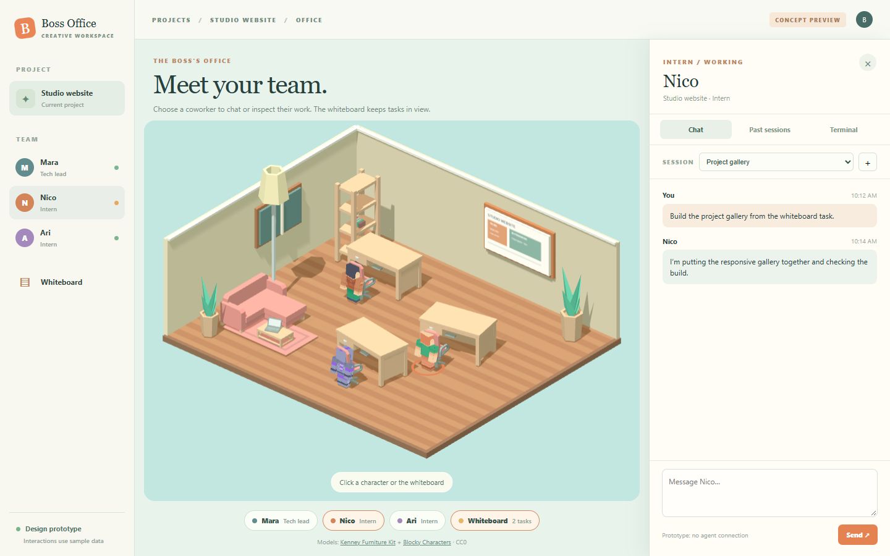

# Isometric office prototype

A standalone interactive office concept for an intern and tech lead workspace. Select one of the three 3D characters to open its panel with chat, past sessions, and terminal activity. Select the whiteboard to view its task panel.



## Run locally

With Node.js 22 or newer:

```powershell
node server.mjs
```

Open <http://127.0.0.1:5180>.

## Deploy on Vercel

Import this repository into Vercel. Use the **Other** framework preset, keep the repository root as the root directory, and leave the build command empty. The site is plain HTML, CSS, JavaScript, and static model files; it has no build step.

The UI is a prototype. Chat messages and new sessions are stored in your browser's local storage. The character responses, terminal activity, past sessions, and whiteboard tasks are sample content; no agent service is connected.

## Asset licenses

- [Kenney Furniture Kit](https://kenney.nl/assets/furniture-kit): selected GLB models in `assets/furniture`.
- [Kenney Blocky Characters](https://kenney.nl/assets/blocky-characters): three GLB models and their textures in `assets/characters`.

Both packs were downloaded from Kenney. Their original `LICENSE.txt` files are included; both are released under [Creative Commons CC0](https://creativecommons.org/publicdomain/zero/1.0/).

The Three.js viewer files in `vendor` retain the Three.js MIT license. The room shell and whiteboard are prototype geometry.
